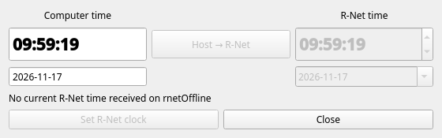
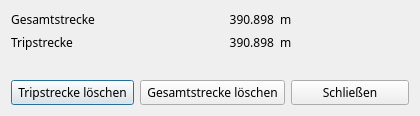
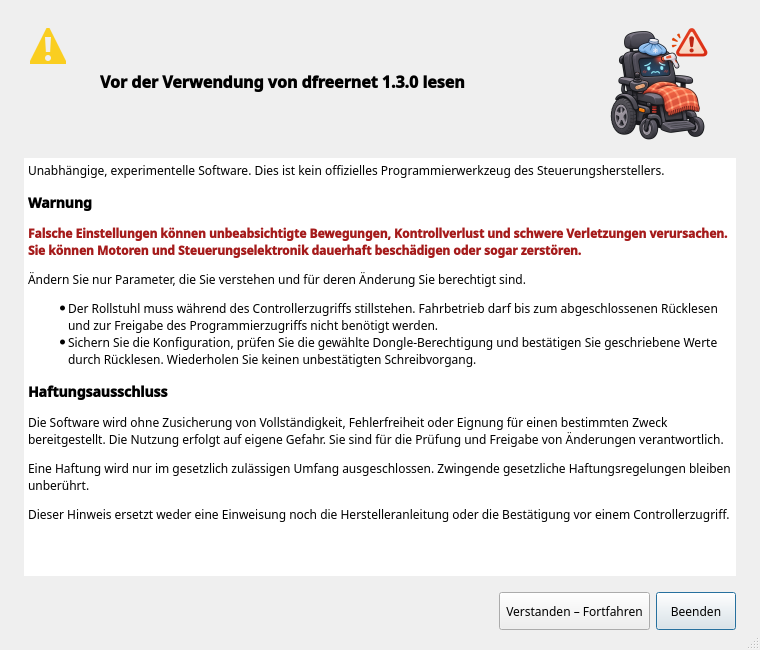
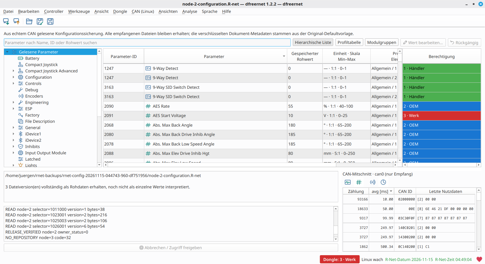
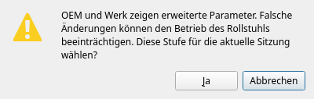
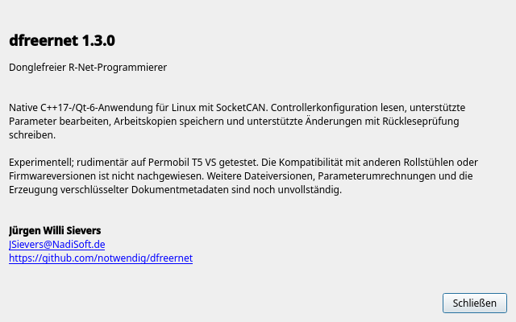

# dfreernet

[English](README.md) | [Deutsch](README.de.md)

**Dongle free R-Net Programmer** · Native Linux-Anwendung · C++17 / Qt 6 / SocketCAN

Experimentelle Desktopanwendung zum Lesen von R-Net-Controllerkonfigurationen, Bearbeiten unterstützter Parameter und Speichern von Konfigurationsdateien. Die Verbindung erfolgt über Linux SocketCAN ohne Programmierdongle, Wine oder FTDI-/CUSBMsg-Laufzeit-DLLs. Der geprüfte Parameterkatalog, Menü-/Textressourcen, kryptografische Konstanten und die Konfigurationsvorlage sind in die nativen Binärdateien eingebettet. Build und Betrieb verwenden ausschließlich eingecheckte Ressourcen und installierte Linux-Bibliotheken.

**Lizenz:** Eigenständig erstellter Code steht unter [GPL-3.0-only](LICENSE). Der eingebettete Katalog und weitere von Dritten abgeleitete Inhalte sind ausgenommen; siehe [Geltungsbereich](SCOPE.de.md). Die Weitergabe der vollständigen Anwendung ist damit nicht freigegeben.

**Teststand: rudimentär auf Permobil T5 VS getestet.** Dies sind begrenzte Entwicklungsversuche, keine allgemeine Kompatibilitätszusage oder Herstellerfreigabe. Andere Rollstuhlmodelle, Steuerungsvarianten und Firmwarestände sind nicht bestätigt. Siehe [Teststand und Grenzen](docs/VALIDATION.de.md).

Linux-Begleitsteuerung: [R-net-BGM-Unterprojekt](qt_attendant/README.de.md). Start ohne Optionen mit `qt_attendant/run.sh` auf `can0`; Anmeldung, Übernahme/Rückgabe, Fahr-/Sitzmodus und separate Speed-Regelung für den getesteten Gerätebestand.

## Version 1.5.1

Version 1.5.1 aktualisiert [R-Net Steuerung, die Linux-Begleitsteuerung](qt_attendant/README.de.md), mit Tray-Start, Steuerungspause, Autostart und geprüfter Wiederaufnahme am bereits laufenden System. Schließen blendet das Fenster in den Tray aus; vollständig beenden lässt sich die App im Tray-Kontextmenü. Ein privates Anmeldeprofil ist erforderlich und wird nicht mitgeliefert. **Das originale BGM muss vor dem Start des Emulators vom R-net-Bus abgeklemmt sein und während des gesamten Emulationsbetriebs abgeklemmt bleiben.** [Änderungsprotokoll](CHANGELOG.de.md) und [Teststand](docs/VALIDATION.de.md) beschreiben den geprüften Umfang. Galvanische Trennung bleibt erforderlich; Raspberry-Pi-Hardware wurde nicht gesondert geprüft.

### Factory-Unterstützung seit 1.4.1

Version 1.4.1 ergänzt einen optionalen, geprüften Factory-Patch für eine separate Kopie der unterstützten OEM-Programmer-EXE. Start: `DONGLE=Factory wine/run.sh --factory-exe`. Der Patch hebt die Anwendungsstufe auf 3 an und wählt den klassischen Dateidialog für Wine-Kompatibilität. Originaldateien bleiben unverändert und werden nicht mitgeliefert. Offline bestätigt wurden Generic Factory, Dateianhebung, Speichern unter und erneutes Öffnen; Controller-Schreibvorgänge wurden nicht getestet. Unterstützte Prüfsummen und Verwendung stehen im [Wine-Unterprojekt](wine/README.de.md). Die native dfreernet-Anwendung bleibt unabhängig von Wine.

## Bildschirmfotos

Uhr- und Entfernungsdialog in 1.3.1:




Startwarnung mit illustriertem Rollstuhl:



Hauptfenster mit Parametertabelle und Berechtigungsstufen:




<details>
<summary>Weitere Bildschirmfotos: Dongle-Hinweis und Über-Dialog</summary>





</details>

## Schnellstart

Benötigt werden Linux, ein C++17-Compiler, CMake ab 3.21, Ninja, Python 3, zlib-Entwicklungsdateien sowie Qt ab 6.10 mit Widgets/Sql/DBus/LinguistTools, Quick/QuickControls2 für `qt_attendant` sowie Qt Test/QuickTest für den Standard-Testbuild. Auf dem Entwicklungsrechner wird Qt 6.11.2 verwendet. Für Controllerzugriffe siehe [Rollstuhl mit PC oder Raspberry Pi verbinden](#rollstuhl-mit-pc-oder-raspberry-pi-verbinden) weiter unten.

```bash
scripts/build.sh
scripts/build.sh DEBUG  # getrennter Debug-Build
scripts/run.sh
# Gespeicherte Konfiguration öffnen:
scripts/run.sh --document '/absoluter/pfad/konfiguration.R-net'
# Offline-Tests ausführen:
scripts/test.sh
```

Die Programmdateien liegen unter `build/RELEASE/dfreernet` (Standard) und `build/DEBUG/dfreernet`. Mit `DFREERNET_BUILD_MODE=DEBUG` nutzen `scripts/run.sh`, `scripts/test.sh`, `scripts/package.sh` und Python-Integrationstests den Debug-Build. Das Startskript funktioniert unabhängig vom Ort dieses Projekts. `scripts/package.sh` erstellt ein verschiebbares lokales Programmverzeichnis; Start mit `dist/dfreernet/bin/dfreernet`. Das vollständige Verzeichnis einschließlich Controller-Hilfsprogrammen kopieren. Auf dem Zielrechner müssen Qt ab 6.10 einschließlich Sql-Modul/QSQLITE-Treiber und zlib installiert sein; Wine und Originalprogramm werden nicht benötigt.

Bei jedem interaktiven Start erscheint eine Warnung mit Haftungsausschluss. Erst die bewusste Auswahl von „Fortfahren“ öffnet die Anwendung. Standardsprache ist US-Englisch; Deutsch ist unter Sprache beziehungsweise **Bearbeiten → Einstellungen → Allgemein** verfügbar. Vorhandene Einstellungen der früheren Anwendung „R-net Qt“ werden einmalig übernommen, sofern noch keine dfreernet-Einstellungen existieren.

## Rollstuhl mit PC oder Raspberry Pi verbinden

„Dongle free“ bedeutet, dass kein proprietärer Programmierdongle benötigt wird. Für die Verbindung zwischen dem CAN-Bus des Rollstuhls und Linux ist weiterhin Hardware nötig. **Ein USB-Kabel allein stellt diese Verbindung nicht her.** SocketCAN ist die Linux-Schnittstelle, über die dfreernet diese Hardware anspricht; `can0` ist ein Schnittstellenname und keine Buchse am Rollstuhl.

**Zwischen dem CAN-Bus des Rollstuhls und dem Rechner/Pi ist galvanische Trennung erforderlich.** Einen Adapter mit dokumentierter Trennbarriere für CAN-Signale und CAN-seitige Stromversorgung verwenden. Diese Barriere nicht durch Masse-, Schirm- oder zusätzliche Versorgungsverbindungen überbrücken; die Anschlussvorgaben des Adapterherstellers beachten.

### Benötigte Hardware

- Ein Linux-PC mit den oben genannten Softwarevoraussetzungen oder ein Raspberry Pi mit Linux und denselben Voraussetzungen. Raspberry-Pi-Kompatibilität wurde in diesem Projekt nicht gesondert geprüft; vor der Wahl des Betriebssystems die Qt-Verfügbarkeit prüfen.
- Ein **galvanisch getrennter, SocketCAN-kompatibler USB-CAN-Adapter** für klassisches CAN mit erweiterten Kennungen (29 Bit) und passender Bitrate. Die Linux-Treiberdokumentation des Adapters prüfen: Ein USB-Seriell-/FTDI-Kabel ist kein CAN-Adapter. Die Trennung muss die CAN-Seite einschließlich ihrer Stromversorgung umfassen; ein isolierter Transceiver allein belegt keine vollständige Trennung des Adapters.
- Ein korrekt beschaltetes **R-net-Abzweig-/T-Kabel**, passend zu den Steckern des Rollstuhls, sodass die vorhandenen Module verbunden bleiben. Das Projekt liefert weder Kabel noch eine verifizierte Steckerzeichnung oder eine geprüfte Adapter-Einkaufsliste. Steckerorientierung und Beschaltung vor dem Anschluss von einer mit R-net-Elektronik vertrauten Person prüfen lassen.

Ein Raspberry Pi kann denselben USB-Adapter verwenden. Ein CAN-HAT ist eine weitere Möglichkeit, muss aber dieselbe galvanische Trennung einschließlich CAN-seitiger Stromversorgung bieten und benötigt CAN-Controller **und Transceiver**, passende GPIO-Spannungspegel sowie die Treiber-/Device-Tree-Einrichtung des Herstellers. R-net-Leitungen nicht direkt mit GPIO verbinden. Der Pi führt dfreernet lokal aus; das Projekt stellt derzeit keine CAN-Netzwerkbrücke vom Pi zum Desktop bereit.

### Physischer Anschluss

```text
Linux-PC oder Raspberry Pi mit dfreernet
    │ USB
Galvanisch getrennter SocketCAN-USB-CAN-Adapter
    │ CAN_H / CAN_L / CAN-Bezugsmasse (nach Adapteranleitung)
R-net-Abzweig-/T-Kabel ─── vorhandener R-net-Bus und Rollstuhlmodule
```

Die Zeichnung zeigt Signale, **keine Positionen im Stecker**:

| R-net-Signal | Anschluss am Adapter |
| --- | --- |
| CAN_H | CAN_H |
| CAN_L | CAN_L |
| CAN-Bezugsmasse | Isolierte CAN-seitige Bezugsmasse gemäß Adapterhersteller; nicht mit USB-/PC-/Pi-Masse überbrücken |
| Versorgungsspannung des Rollstuhls | **Nicht mit USB, GPIO oder der Logikversorgung des Adapters verbinden** |

Den Rollstuhl stillstehen lassen und vor Einbau oder Entfernen des Abzweigs ausschalten. Einen geprüften R-net-Busanschluss verwenden, nicht die Ladebuchse. Steckerorientierung, Aderfarben und DB9-Belegung müssen zum tatsächlichen Kabel und Adapter passen; sie lassen sich aus dieser Tabelle nicht ableiten. Vorhandene Busabschlusswiderstände erhalten und einen zusätzlichen 120-Ω-Abschluss am Adapter nur aktivieren, wenn der geprüfte Busaufbau ihn erfordert. Rechner/Pi bei diesem Aufbau separat geeignet versorgen; Versorgung über den Rollstuhl benötigt eine gesonderte, fachgerecht ausgelegte Stromversorgung.

### Linux einrichten und Empfang prüfen

`iproute2` und `can-utils` über die Paketverwaltung installieren. Unter Debian-/Ubuntu-basierten Systemen:

```bash
sudo apt install iproute2 can-utils
```

Den Adapter mit dem Rechner verbinden und seine Treiberanleitung befolgen. Schnittstellen anzeigen:

```bash
ip -brief link
```

Nach `can0` oder einem anderen CAN-Schnittstellennamen suchen. Fehlt eine CAN-Schnittstelle, zuerst Treiber/Firmware des Adapters einrichten; dfreernet kann eine fehlende Hardwareschnittstelle nicht erzeugen. Das folgende Beispiel verwendet **125000 Bit/s**, wie am Entwicklungsrollstuhl. Vor Ausführung die richtige Bitrate für die Steuerung prüfen und `can0` durch den tatsächlichen Schnittstellennamen ersetzen:

```bash
sudo ip link set dev can0 down
sudo ip link set dev can0 type can bitrate 125000
sudo ip link set dev can0 up
ip -details -statistics link show dev can0
```

Nach Prüfung der Verkabelung den Rollstuhl normal einschalten und empfangenen Verkehr anzeigen:

```bash
candump can0
# Mit Strg+C beenden.
```

`candump` zeigt CAN-Frames an, ohne Anwendungsnachrichten zu senden. Der Adapter kann im Normalbetrieb dennoch Busverkehr quittieren; dies ist kein Hardware-Listen-only-Modus. Schnittstellenmodi beschreibt die [Linux-SocketCAN-Dokumentation](https://docs.kernel.org/networking/can.html), Diagnosewerkzeuge das [can-utils-Projekt](https://github.com/linux-can/can-utils).

Keine Ausgabe beweist keinen Rollstuhldefekt: Einschaltzustand, gewählte Schnittstelle, Bitrate und Verbindung zum richtigen Bus prüfen. Steigende Fehlerzähler oder `BUS-OFF` weisen auf ein Kommunikationsproblem hin; vor Controllerzugriffen anhalten und Verkabelung, Bitrate sowie Abschlusswiderstände prüfen. Keine Testframes zur Fehlersuche an einem unbekannten Rollstuhl senden.

### Verbindung in dfreernet auswählen

`scripts/run.sh` starten und unter **Bearbeiten → Einstellungen → CAN** die eingerichtete Schnittstelle auswählen. **CAN beim Start einrichten und aktivieren** ausgeschaltet lassen, wenn die Einrichtung manuell erfolgte. Empfangener Verkehr erscheint im CAN-Mitschnitt; das Herz erkennt nur den dokumentierten Heartbeat und bestätigt keine Kompatibilität. Controller-Lesevorgänge senden aktiv Anfragen und können das Fahren vorübergehend sperren. Den Rollstuhl stillstehen lassen, vor Änderungen eine Sicherung lesen und aufbewahren und für Controllerzugriffe die [Bedienungsanleitung](docs/USER-GUIDE.de.md) befolgen.

Gespeicherte `.R-net`-Dateien lassen sich auch ohne CAN-Hardware erkunden. Das optionale [Wine-Unterprojekt](wine/README.de.md) verwendet dieselbe physische CAN-Verbindung; es ersetzt weder Adapter noch Abzweigkabel.

## Funktionen

- Controllerkonfiguration lesen und empfangene Nutzdaten einschließlich unbekannter Blöcke erhalten.
- Zum installierten Katalog und zur gelesenen Dateiversion passende Parameter anzeigen und nach Berechtigung filtern.
- Unter Ansichten zwischen Kategorienliste, Profilansicht und Modulgruppen wechseln. Die Profilansicht zeigt links Allgemein und Profil 1–8; die Modulansicht gruppiert nach Katalogmodulen. Alle Ansichten nutzen dieselben gelesenen Werte, Suche, Berechtigungen und Editoren.
- Die drei Ansichtsschaltflächen stehen direkt neben dem Suchfeld.
- Spaltenbreiten und -reihenfolge bleiben für jede Tabelle automatisch erhalten; unter Ansichten gibt es zusätzlich Speichern, Laden und Zurücksetzen.
- Die Profilansicht zeigt das zugehörige Modul und die Gruppe; gleich benannte Parameter mit unterschiedlichen IDs bleiben unterscheidbar.
- Eine kompakte Spalte direkt nach dem Rohwert zeigt Katalogeinheit, Skalierungsfelder und Rohwert-Minimum/-Maximum. Die farbige Berechtigung bleibt rechts auch beim horizontalen Scrollen sichtbar. Eine ungeprüfte Umrechnung in technische Einheiten erfolgt nicht.
- Unterstützte Rohwerte mit geprüften Ja/Nein-, Auswahl-, Zahlen- und Texteditoren bearbeiten; Änderungen erscheinen rot und fett.
- F1 auf einem ausgewählten Parameter öffnet den eingebetteten R-net-Hilfetext mit ID, Profil, Rohwert und Berechtigung.
- `.R-net`-Dateien öffnen und speichern; angezeigte Informationen exportieren.
- Datei → RND-Katalog importieren… prüft eine RND-Datei und schreibt deren Tabellen in eine neue SQLite-Datenbank. Der eingebettete Katalog wird nicht automatisch gewechselt.
- Unterstützte Änderungen mit Sicherung, Vergleich und Rückleseprüfung übertragen. Der Schreibpfad ist begrenzt und experimentell.
- Modulkennungen und Seriennummern abfragen. Unter der fixierten Berechtigungsspalte läuft ein fortlaufender CAN-Mitschnitt nur mit Empfang; „CAN beobachten“ erstellt weiterhin eine zeitlich begrenzte Zusammenfassung. CAN-Zähltabellen lassen sich über ihre Spaltenköpfe sortieren.
- Den waagerechten Trenngriff für die Höhe und den Trenngriff neben dem CAN-Mitschnitt für dessen Breite ziehen; die Positionen bleiben nach dem Neustart erhalten.
- Passiven CAN-Heartbeat als pulsierendes Herz rechts in der Statusleiste anzeigen.
- R-Net-Datum und -Uhrzeit in der Statusleiste anzeigen, Abweichungen farbig markieren und die Uhr nach Bestätigung per Klick auf die Host-Zeit stellen.
- Linux während der App-Nutzung wach halten; optionales Warnblinker-Signal nur für die aktuelle Sitzung (Standardintervall 300 s, Dauer 60 s; verlangt die Bestätigung „sichtbar aus“ und verhindert den Rollstuhl-Ruhezustand nicht).
- Die ausgewählte CAN-Schnittstelle nach Annahme der Startwarnung optional mit gespeicherter Bitrate einrichten und einschalten.
- CAN-, Ordner-, Sprach- und Darstellungseinstellungen in vertikalen Reitern speichern.

## Nativer IR-Editor

Eigenständiger Qt-Editor für `.RnIR3`-Menüs und eigene Pronto-Hex-Codes. Start mit `qt_iredit/run.sh`. [Anleitung und Formatgrenzen](qt_iredit/README.de.md).

## Dokumentation

| Dokument | Inhalt |
| --- | --- |
| [Bedienung](docs/USER-GUIDE.de.md) | Einrichtung und Arbeitsabläufe |
| [Teststand und Grenzen](docs/VALIDATION.de.md) | Tatsächliche Erprobung, Nachweise und offene Punkte |
| [Entwicklung](docs/DEVELOPMENT.de.md) | Build, Struktur, Übersetzungen und Prüfungen |
| [Änderungen](CHANGELOG.de.md) | Aktueller Änderungsstand |

## Projektstruktur

```text
qt_attendant/    Linux-R-net-Begleitsteuerung
qt_iredit/       Offline-Qt-Editor für IR-Menüs und Pronto-Hex
src/             Nativer Kern, SocketCAN-Werkzeuge und Qt-Oberfläche
translations/    Deutscher Qt-Linguist-Katalog; englische Quelltexte
scripts/         Build, Start, Paketierung, virtuelle CAN-Tests und Katalogwerkzeuge
tests/           Automatisierte Tests; private Referenzdaten bleiben lokal
resources/       Geprüfter SQLite-Katalog und Datenherkunft
docs/            Aktuelle zweisprachige Dokumentation
analysis/        Private Mitschnitte, Berichte und Screenshots (generiert)
checkpoints/     Wiederherstellbare lokale Sicherungen
build/           Generierte DEBUG- und RELEASE-Builds
```

Historische Untersuchungen, lokale Sicherungen, Controller-Mitschnitte, persönliche Konfigurationen und Build-Ausgaben bleiben außerhalb von Git. Das Repository enthält den Quellcode der nativen Anwendung und den festgelegten Laufzeitkatalog; die eingebetteten abgeleiteten Daten sind von der Codelizenz ausgenommen.

## Nutzung und Weitergabe

Unabhängige experimentelle Software; kein offizielles Werkzeug von Permobil oder dem Steuerungshersteller. Falsche Einstellungen können den Rollstuhl blockieren oder unbeabsichtigte Bewegungen auslösen. Vor Controllerzugriffen die Programmwarnung und [Bedienungsanleitung](docs/USER-GUIDE.de.md) lesen. Eine unabhängige Sicherung behalten und Änderungen durch Rücklesen prüfen.

Der eigenständig erstellte Code steht im beschriebenen [Geltungsbereich](SCOPE.de.md) unter GPL-3.0-only. Die eingebetteten Daten wurden einmalig aus lokal geprüften Referenzressourcen abgeleitet; siehe [Datenherkunft](resources/PROVENANCE.de.md). Laufzeitunabhängigkeit begründet keine Weitergaberechte an diesen Daten. Dieses Projekt erteilt keine Weitergaberechte an Originalsoftware, Katalogen, Dokumenten, Mitschnitten oder Binärdateien. Produkt- und Firmennamen dienen der Beschreibung des Kompatibilitätskontexts; eine Unterstützung durch deren Inhaber wird nicht behauptet.
