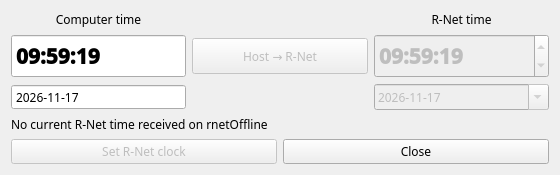
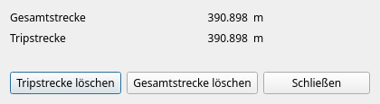
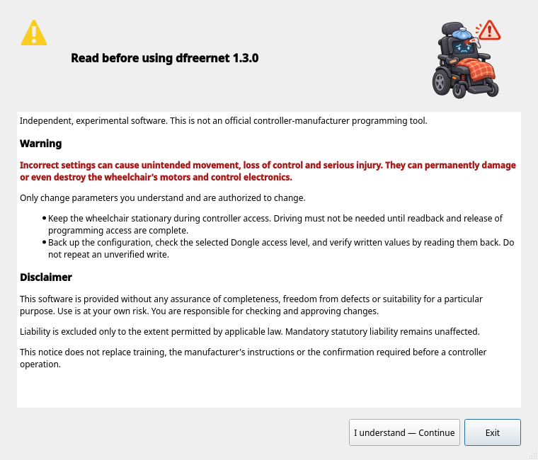
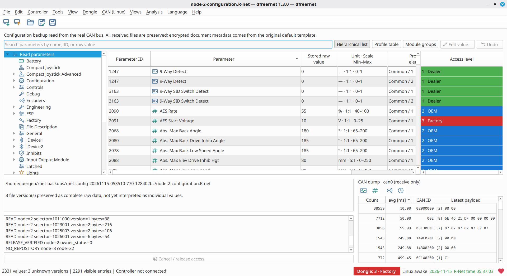
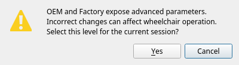
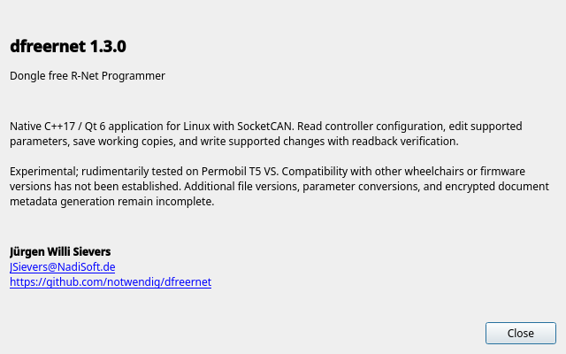

# dfreernet

[English](README.md) | [Deutsch](README.de.md)

**Dongle free R-Net Programmer** · Native Linux application · C++17 / Qt 6 / SocketCAN

An experimental desktop application for reading R-Net controller configurations, editing supported parameters, and saving configuration files. It connects through Linux SocketCAN without a programmer dongle, Wine, or FTDI/CUSBMsg runtime DLLs. The verified parameter catalog, menu/text resources, cryptographic constants and configuration-document template are embedded in the native binaries. Build and runtime use only checked-in resources and installed Linux libraries.

**License:** Original code is [GPL-3.0-only](LICENSE). The bundled catalog and other third-party-derived materials are excluded; see the [license scope](SCOPE.md). A complete bundled application is not cleared for redistribution.

**Test status: rudimentarily tested on Permobil T5 VS.** This is limited development testing, not a general compatibility claim or manufacturer approval. No compatibility with other wheelchair models, controller variants or firmware versions is established. See [validation and limitations](docs/VALIDATION.md).

## Version 1.4.2

Version 1.4.2 adds a beginner connection guide with required galvanic isolation, system timers and diagnostics, graphical OEM/IR launchers, and verified Wine download-timeout corrections in separate runtime copies. See the [changelog](CHANGELOG.md) and [Wine subproject](wine/README.md) for details. Controller access remains experimental; Raspberry Pi hardware has not been separately validated.

### Factory support since 1.4.1

Version 1.4.1 adds an optional, verified Factory patch for a separate copy of the supported OEM Programmer EXE. Start it with `DONGLE=Factory wine/run.sh --factory-exe`. The patch raises the application access limit to 3 and selects the classic file dialog for Wine compatibility. Original binaries remain unchanged and are not distributed. Offline testing confirmed Generic Factory, file promotion, Save As and reopening the saved file; controller writes were not tested. See the [Wine subproject](wine/README.md) for supported checksums and usage. The native dfreernet application remains independent of Wine.

## Screenshots

Clock settings and distance dialogs in 1.3.1:




Startup warning with the illustrated wheelchair:



Main window with the parameter table and access levels:



<details>
<summary>More screenshots: Dongle access warning and About dialog</summary>





</details>

## Quick start

Requires Linux, a C++17 compiler, CMake 3.21+, Ninja, Python 3, zlib development files, Qt 6.10+ Widgets/Sql/DBus/LinguistTools and Qt Test for the default test build. The development machine currently uses Qt 6.11.2. For controller access, follow [Connecting a wheelchair to a computer or Raspberry Pi](#connecting-a-wheelchair-to-a-computer-or-raspberry-pi) below.

```bash
scripts/build.sh
scripts/build.sh DEBUG  # separate debug build
scripts/run.sh
# Open a saved configuration:
scripts/run.sh --document '/absolute/path/configuration.R-net'
# Run the offline test suite:
scripts/test.sh
```

The native executables are `build/RELEASE/dfreernet` (default) and `build/DEBUG/dfreernet`. Set `DFREERNET_BUILD_MODE=DEBUG` for `scripts/run.sh`, `scripts/test.sh`, `scripts/package.sh`, or Python integration scripts. The launcher works from this checkout at any location. For a relocatable local application directory, run `scripts/package.sh`, then start `dist/dfreernet/bin/dfreernet`. Copy the complete directory, including its controller helper programs. The target machine needs Qt 6.10+ including the Sql module/QSQLITE driver, and zlib installed; no Wine or original programmer is needed.

A warning and disclaimer appears at every interactive start. Choose Continue deliberately to enter the application. The interface defaults to US English; German is available through Language or **Edit → Settings → General**. Existing preferences from the former “R-net Qt” application are copied once when no dfreernet preferences exist.

## Connecting a wheelchair to a computer or Raspberry Pi

“Dongle free” means that no proprietary programmer dongle is needed. You still need hardware to connect the wheelchair's CAN bus to Linux. **A USB cable alone cannot make this connection.** SocketCAN is the Linux interface through which dfreernet talks to that hardware; `can0` is an interface name, not a connector on the chair.

**Galvanic isolation is required between the wheelchair CAN bus and the computer/Pi.** Use an adapter with a documented isolation barrier for both CAN signals and CAN-side power. Do not bridge that barrier with a ground, shield or separate power connection; follow the adapter manufacturer's wiring instructions.

### What you need

- A Linux computer with the software requirements above, or a Raspberry Pi running Linux with the same requirements. Raspberry Pi compatibility has not been separately validated by this project; check Qt availability before choosing an OS image.
- A **galvanically isolated, SocketCAN-compatible USB-to-CAN adapter** supporting classic CAN with extended (29-bit) identifiers and the required bitrate. Check the adapter's Linux driver documentation: a USB-to-serial/FTDI cable is not a CAN adapter. The isolation must cover the CAN side, including its power supply; an isolated transceiver alone does not establish isolation of the complete adapter.
- A correctly wired **R-net breakout/T cable** matching the chair's connectors, so the existing modules remain connected. The project does not supply a cable, a verified connector drawing or a tested adapter shopping list. Have the connector orientation and wiring checked by someone familiar with R-net electronics before connecting it.

A Raspberry Pi can use the same USB adapter. A CAN HAT is another possible route, but it must provide the same galvanic isolation, including CAN-side power, and needs a CAN controller **and transceiver**, compatible GPIO voltage levels, and its vendor's driver/device-tree setup. Do not connect the R-net wires directly to GPIO. The Pi runs dfreernet locally; the project does not currently provide a remote Pi-to-desktop CAN bridge.

### Physical connection

```text
Linux PC or Raspberry Pi running dfreernet
    │ USB
Galvanically isolated SocketCAN USB-to-CAN adapter
    │ CAN_H / CAN_L / CAN reference ground (per adapter instructions)
R-net breakout/T cable ─── existing wheelchair R-net bus and modules
```

This diagram shows signals, **not connector pin positions**:

| R-net signal | Adapter connection |
| --- | --- |
| CAN_H | CAN_H |
| CAN_L | CAN_L |
| CAN reference ground | Isolated CAN-side reference ground, as specified by the adapter manufacturer; do not bridge to USB/PC/Pi ground |
| Chair supply voltage | **Do not connect to USB, GPIO, or the adapter's logic supply** |

Keep the chair stationary and switch it off before fitting or removing the breakout. Use a verified R-net bus connection, not the charging socket. Connector orientation, wire colors and DB9 pin assignments must be checked for the actual cable and adapter; do not infer them from this table. Preserve the existing bus termination and do not enable an adapter's extra 120 Ω terminator unless the verified bus layout requires it. Power the computer/Pi from its own suitable supply for this setup; powering it from the chair requires a separate, appropriately engineered power supply.

### Set up Linux and check reception

Install `iproute2` and `can-utils` using your distribution's package manager. On Debian/Ubuntu-based systems:

```bash
sudo apt install iproute2 can-utils
```

Connect the adapter to the computer and follow its driver instructions. List interfaces:

```bash
ip -brief link
```

Look for `can0` or another CAN interface name. If none appears, resolve the adapter driver/firmware setup first; dfreernet cannot create a missing hardware interface. The following example uses **125000 bit/s**, as used on the development chair. Confirm the bitrate for your controller and replace `can0` with your actual interface name before running it:

```bash
sudo ip link set dev can0 down
sudo ip link set dev can0 type can bitrate 125000
sudo ip link set dev can0 up
ip -details -statistics link show dev can0
```

With the wiring checked and the chair switched on normally, inspect received traffic:

```bash
candump can0
# Stop with Ctrl+C.
```

`candump` displays CAN frames without sending application messages. The adapter in normal mode may still acknowledge bus traffic; this is not hardware listen-only mode. See the [Linux SocketCAN documentation](https://docs.kernel.org/networking/can.html) for interface modes and the [can-utils project](https://github.com/linux-can/can-utils) for the diagnostic tools.

No output does not prove a defective chair: check that it is on, the selected interface and bitrate are correct, and the cable is connected to the right bus. Increasing error counters or `BUS-OFF` indicate a communication problem; stop and check the wiring, bitrate and termination before attempting controller access. Do not send test frames to troubleshoot an unfamiliar chair.

### Select the connection in dfreernet

Start `scripts/run.sh`, then open **Edit → Settings → CAN** and select the interface you configured. Leave **Configure and enable CAN at startup** off if you set it up manually. Received traffic appears in the CAN dump; the heart indicator only recognizes the documented heartbeat and does not establish compatibility. Controller reads actively send requests and can temporarily inhibit driving. Keep the chair stationary, read and retain a backup before editing, and follow the [user guide](docs/USER-GUIDE.md) for controller operations.

You can also explore saved `.R-net` files without any CAN hardware. The optional [Wine subproject](wine/README.md) uses the same physical CAN connection; it does not replace the adapter or breakout cable.

## Main functions

- Read controller configuration and preserve received payloads, including unsupported blocks.
- Show parameters supported by the installed catalog and the received file version; filter by access level.
- Switch under Views between the category list, profile view, and module groups. The profile view lists Common and Profiles 1–8; the module view groups parameters by their catalog module. All use the same read values, search, access filter and editors.
- All three view buttons are visible beside the search field.
- Column widths and order persist automatically for each table; Views also offers save, load and reset actions.
- The profile table identifies the source module/group, so parameters with the same name but different IDs remain distinguishable.
- One compact column after the raw value shows catalog unit, scale fields, and raw minimum/maximum. The colored access column stays visible on the right while scrolling horizontally. No unverified engineering-unit conversion is applied.
- Edit supported raw values using validated boolean, selection, number and text editors. Pending changes appear red and bold.
- Press F1 on a selected parameter to open its bundled R-net catalog help text with ID, profile, raw value and access context.
- Open and save `.R-net` files; export displayed information.
- File → Import RND catalog… validates an RND file and exports its tables to a new SQLite database. The built-in catalog is not switched automatically.
- Write supported parameter changes with backups, comparison and readback verification. This is a bounded experimental implementation.
- Query module identifiers and serial numbers. A continuous receive-only CAN dump appears below the fixed access column; the separate Monitor CAN command still provides a timed capture summary. CAN count tables can be sorted by clicking column headers.
- Drag the lower horizontal divider to adjust pane height and the divider beside the CAN dump to adjust its width; these positions are restored on restart.
- Show a passive CAN heartbeat as a pulsating heart at the right of the status bar.
- Show R-Net date and time in the status bar, with colors for mismatches and a click action to set the clock to host time after confirmation.
- Keep Linux awake while the app is open; optional session-only hazard-light experiment (default interval 300 s, duration 60 s; requires physical OFF-state confirmation and does not prevent wheelchair sleep).
- Optionally configure and enable the selected CAN interface at startup with a saved bitrate, after accepting the startup warning.
- Store CAN, folder, language and appearance preferences in grouped vertical settings tabs.

## Documentation

| Document | Purpose |
| --- | --- |
| [User guide](docs/USER-GUIDE.md) | Setup and operating instructions (English / German) |
| [Validation and limitations](docs/VALIDATION.md) | Actual test scope, evidence and known gaps |
| [Development](docs/DEVELOPMENT.md) | Build, structure, translations and checks |
| [Changelog](CHANGELOG.md) | Current changes |

## Project layout

```text
src/             Native core, SocketCAN tools and Qt interface
translations/    Qt Linguist German catalog; English source strings
scripts/         Build, launch, packaging, virtual CAN checks and catalog tools
tests/           Automated tests; private reference fixtures stay local
resources/       Pinned SQLite catalog and resource provenance
docs/            Current bilingual documentation
analysis/        Private captures, reports and screenshots (generated)
checkpoints/     Recoverable source snapshots (local)
build/           Generated DEBUG and RELEASE builds
```

Historical investigation files, local checkpoints, controller captures, personal configurations and build outputs remain outside Git. The repository contains the native application sources and the pinned runtime catalog; the bundled derived data are excluded from the code license.

## Use and distribution

Independent experimental software; not an official Permobil or controller-manufacturer tool. Incorrect settings can disable a wheelchair or cause unintended movement. Read the application warning and the [user guide](docs/USER-GUIDE.md) before controller access. Retain an independent backup and verify changes by reading back.

The independently authored code is licensed under GPL-3.0-only within the stated [scope](SCOPE.md). Embedded data were derived once from locally verified reference resources; see [resource provenance](resources/PROVENANCE.md). Runtime independence does not establish redistribution rights for these data. Original software, catalogs, documents, captures and binaries are not licensed for redistribution by this project. The product and company names identify compatibility context only; no endorsement is implied.
