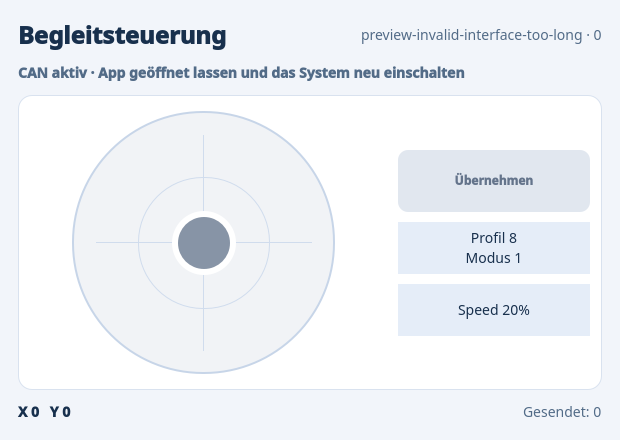
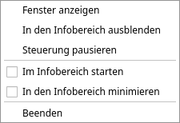
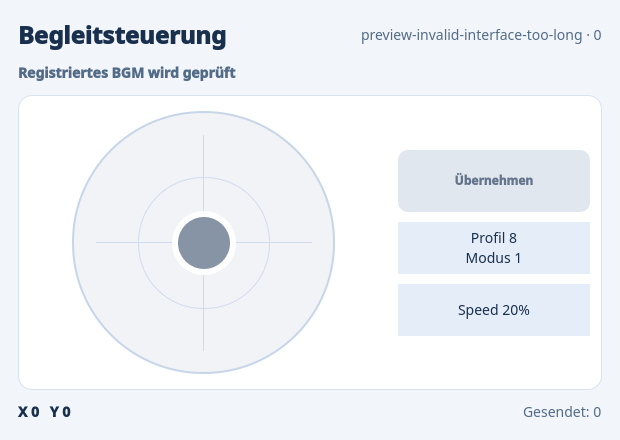

# R-Net Steuerung für Linux

[English](README.md) | [Deutsch](README.de.md)

Teil von dfreernet 1.5.1. Fenster, Tray und Starter verwenden den Namen **R-Net Steuerung** und ein gemeinsames blaues Joystick-Symbol.

Qt-6-/C++17-Anwendung für die hier aufgezeichnete und getestete R-net-Konfiguration: Begleitgerät in Slot 0, Fahrergerät in Slot 1, PM in Slot 3 und Begleitprofil 8. Modus 1 ist Fahren, Modus 2 Sitzverstellung. Gerätebestand, Identitäten und Starttabellen kommen aus einem privaten Profil.

## Start ohne Optionen

**Das originale BGM (Begleitsteuerungsmodul) muss vor dem Start des Emulators vom R-net-Bus abgeklemmt sein und während des gesamten Emulationsbetriebs abgeklemmt bleiben.** Emulator und Original verwenden dieselbe aufgezeichnete Modulkennung und denselben Slot; sie dürfen nicht gleichzeitig am Bus aktiv sein.

```sh
qt_attendant/run.sh
```

Oder nach dem Bauen:

```sh
build/RELEASE/qt_attendant
```

Die Anwendung **vor dem Einschalten des Rollstuhls** öffnen. Standard ist Steuerungsbetrieb auf `can0`. `run.sh` richtet vor dem App-Start **can0 und can1 mit 125.000 Bit/s** ein und schaltet beide auf UP. Bereits mit dieser Bitrate aktive Adapter bleiben unverändert. Beim direkten Start der Binärdatei müssen die Schnittstellen bereits eingerichtet sein. Anschluss und galvanische Trennung beschreibt die [Verbindungsanleitung](../README.de.md).

Für die Einrichtung werden `ip` (iproute2) und Python 3 benötigt. Fehlen Netzwerkrechte, versucht das Skript ausschließlich die nötigen `ip link set`-Befehle über `sudo -n`; die App selbst läuft als normaler Benutzer. Falls sudo ein Passwort verlangt, zuerst `sudo -v` im selben Terminal ausführen und danach `qt_attendant/run.sh` erneut starten. Beide Adapter müssen vorhanden sein. Fehlende Adapter, eine belegte Schnittstellen-Sperre oder ein Einrichtungsfehler verhindern den App-Start. Bereits erfolgte Einrichtungsschritte bleiben bei einem späteren Fehler bestehen. Für eine andere bekannte Bus-Bitrate kann `RNET_BITRATE` gesetzt werden; Standard ist `125000`. Die App verwendet weiterhin standardmäßig nur `can0`; `can1` wird eingerichtet, aber nicht von ihr verwendet.

Das BGM nimmt beim Einschalten am gemeinsamen Gerätedialog teil. Ein unbekanntes vorhandenes BGM wird auf Systemanforderung registriert; ein fehlendes zuvor registriertes BGM wird nach der Benutzerbeobachtung vom System ausgetragen. Der Emulator bleibt deshalb über Aus-/Einschaltzyklen geöffnet. **Ist das BGM bereits registriert und der Bus läuft, kann ein neu gestarteter App-Prozess die bestehende Zuordnung prüfen und wieder aktiv werden.** Dafür ist die unten beschriebene private Wiederanbindungsreferenz erforderlich. Ohne diese Referenz wartet die App weiter auf den gemeinsamen Einschaltvorgang. Ausblenden und Steuerungspause erhalten die Modulverbindung. Nach einem tatsächlich erkannten Power-down oder Verlust einer zuvor verbundenen Schnittstelle gilt weiterhin die Sperre bis zum nächsten `00C`.

Hinweis bei Profilen ohne Wiederanbindungsreferenz (offline, synthetische Schnittstelle):



Die App sendet zunächst ihren normalen Identitätsblock. Erkennt das System das registrierte BGM, folgt der normale Start. Fordert das System ausdrücklich eine Erst-Anmeldung an, beantwortet die App diese nach Prüfung des bekannten Gerätebestands. Sie überträgt ausschließlich die eigenen Slot-0-Tabellen und wartet abschnittsweise auf passende Antworten der anderen Geräte. Nach einer Erst-Anmeldung zeigt sie den erforderlichen Neustart an. Beim nächsten Einschalten bleibt die App geöffnet und versucht wieder den normalen Start. Es gibt keine Wiederholschleife nach einer Ablehnung oder Zeitüberschreitung.

Die Übernahme ist erst nach vollständig bestätigtem Identitäts-, Konfigurations- und Bereitschaftsdialog möglich. Sie erfolgt durch die Taste **Übernehmen** bei zentriertem Joystick. Profil-/Moduswechsel und Rückgabe warten zuerst auf die bestätigte Suspendierung. Bei der Rückgabe wählt das reale Fahrergerät seinen Modus; die App bestätigt erst dessen vollständige Antwortfolge.

## Bedienung

Neben dem Joystick gibt es drei Tasten:

- **Übernehmen / Zurückgeben:** Übernahme bei zentriertem Joystick; Rückgabe auch bei ausgelenktem Joystick mit sofortiger Neutralstellung.
- **Profil:** wechselt die beiden Modi innerhalb des festen Begleitprofils 8. Der neue Modus erscheint erst nach seiner Bestätigung.
- **Speed:** durchläuft 0, 20, 40, 60, 80 und 100 %. Der Startwert ist 20 %.

Joystick-Auslenkung und Speed sind getrennt: Der Joystick reicht in allen Modi bis ±100; Speed wird separat über `0A040000` gesendet. Die radiale Begrenzung, Neutralzone und Freigabeprüfung gelten weiter.


Die App bleibt beim Ausschalten des Rollstuhls geöffnet. Ein neues `00C` startet den nächsten Gerätedialog. X, Alt+F4 und normales Fensterschließen blenden die Anwendung im Tray aus. Vollständiges Beenden erfolgt über **Beenden** im Tray-Kontextmenü; dabei sowie bei Strg+C oder SIGTERM versucht sie zuerst die bestätigte Rückgabe. Dieser Ablauf ist begrenzt; fehlt eine Bestätigung, endet die eigene Ausgabe und der Fehler wird protokolliert. Ein nicht abfangbarer Prozessabbruch kann keinen CAN-Dialog mehr ausführen.

## Fehlerbehandlung

- Keine Übernahme vor bestätigter Modulbereitschaft und Steuerungsbestätigung.
- Keine Joystick-/Speed-Ausgabe während ausstehender Moduswahl oder nach Rückgabe.
- Frische Eingaben aus der Bedienoberfläche werden benötigt; ihr Ausbleiben führt nach 250 ms zu Neutralstellung und Rückgabe. Ein gehaltenes Touch-/Maus-Eingabeelement wird aus der laufenden Oberfläche alle 50 ms aktualisiert.
- Beim Fokuswechsel bleiben Anmeldung, Übernahme, Profil/Modus und Speed erhalten. Die Joystick-Auslenkung geht auf Neutral. Die laufende Oberfläche aktualisiert im Hintergrund ausschließlich Neutral; beim Zurückwechseln setzt erst eine neue Betätigung die Bewegung fort. Ohne frische Oberflächenaktualisierung gilt weiterhin die 250-ms-Zeitüberwachung mit Rückgabe.
- `002` als RTR ist die Power-down-Barriere: keine weitere Ausgabe bis zum nächsten Einschaltmarker.
- Schnittstellenverlust, Sendefehler, widersprüchliche Identitäten und ausbleibende Protokollbestätigungen beenden den jeweiligen Ablauf. Die Empfangsverbindung wird erneut versucht; Steuerung setzt einen neuen Einschaltzyklus voraus.
- Pro Schnittstelle ist eine Live-Instanz erlaubt. Der Sender verwendet zusätzlich dieselbe Schnittstellen-Sperre wie die dfreernet-Controllerhelfer.

Die Protokollzustände gelten für den bekannten Gerätebestand. Frühere Tests am stationären Rollstuhl bestätigten Anmeldung/Wiederstart, Übernahme/Rückgabe, direkte Moduswechsel, Sitzverstellung und die minimale Speed-Stufe. Der Benutzer bestätigte anschließend Anmeldung, Deregistrierung, Wiederaufnahme bei laufendem System und Steuerung für diese lokale Konfiguration. Fehler-/Beendigungspfade sind zusätzlich offline geprüft; dies ersetzt keine allgemeine Abnahme oder Langzeiterprobung.

## Systemtray und Steuerungspause

```sh
qt_attendant/run.sh --start-in-tray
qt_attendant/run.sh --minimize-to-tray
qt_attendant/run.sh --no-tray
```

`--start-in-tray` startet im Infobereich. `--minimize-to-tray` blendet das Fenster beim Minimieren dorthin aus. Beide Optionen sind auch im Kontextmenü des Tray-Symbols einstellbar und werden dort für spätere Starts gespeichert. Die Kommandozeilenoptionen gelten für den jeweiligen Start. `--no-tray` ignoriert die gespeicherten Tray-Einstellungen und startet sichtbar. Diagnose-/Offline-Starts verwenden gespeicherte Tray-Einstellungen nicht; für einen lokalen Test kann `--offline --start-in-tray` ausdrücklich gewählt werden.

- **Fenster anzeigen:** Fenster wieder öffnen; auch per Klick auf das Symbol.
- **In den Infobereich ausblenden:** nur das Fenster ausblenden. Anmeldung, Übernahme, Modus und Speed bleiben erhalten, der Joystick geht auf Neutral. Nach Rückkehr ist eine neue Joystick-Betätigung nötig.
- **Steuerung pausieren:** sofort neutral stellen, Bedienung sperren und bestehende Kontrolle über den bestätigten Rückgabedialog an den Fahrer zurückgeben. Das BGM bleibt angemeldet und verbunden. Eine noch laufende Übernahme wird bei ihrer Bestätigung ebenfalls zurückgegeben. Nach bestätigter Rückgabe wird das Fenster automatisch in den Tray ausgeblendet; ohne vorherige eigene Kontrolle sofort. Schlägt die Rückgabe fehl, bleibt das Fenster zur Fehleranzeige geöffnet.
- **Steuerung fortsetzen:** nach abgeschlossener Rückgabe die Bedienung wieder freigeben. Es gibt keine automatische Übernahme; dazu erneut **Übernehmen** drücken. Das Fenster wird wieder angezeigt. Modus und Speed bleiben erhalten.
- **Beenden:** Fenster bei Bedarf zur Statusanzeige öffnen und den üblichen Beendigungsablauf mit Rückgabe ausführen. X, Alt+F4 und normales Fensterschließen beenden die App nicht. Strg+C und SIGTERM verwenden weiterhin den geordneten Beendigungsablauf.

Die Steuerungspause bleibt während eines Rollstuhl-Neustarts erhalten, solange die App läuft. Sie wird beim Neustart der App nicht gespeichert. Ohne verfügbaren Systemtray bleibt das Fenster erreichbar und normales Schließen wird abgefangen. `--no-tray` bleibt eine ausdrückliche Diagnose-/Wiederherstellungsoption mit normalem Fensterschließen; verschwindet der Tray während des Betriebs, wird ein ausgeblendetes Fenster wieder angezeigt. Automatisierte Screenshots erzwingen ein sichtbares Fenster.



## Autostart bei Linux-Anmeldung

Nach dem Bauen einmal ausführen:

```sh
python3 qt_attendant/tools/install_autostart.py
```

Der Installer legt `~/.config/autostart/dfreernet-attendant.desktop` an (`XDG_CONFIG_HOME` wird berücksichtigt). Der vorhandene RELEASE-Build startet bei der nächsten Anmeldung direkt mit `--start-in-tray --minimize-to-tray`, ohne Neubau oder Passwortabfrage. Ein erst später verfügbarer Desktop-Tray wird automatisch erkannt; dann blendet die App ihr Startfenster aus. Eine vorhandene Instanz verhindert einen zweiten Emulator.

Dieser Autostart richtet die CAN-Netzwerkschnittstellen nicht ein. Sie müssen durch Linux oder zuvor mit `qt_attendant/run.sh` eingerichtet werden; bei fehlendem/inaktivem `can0` bleibt die App geöffnet und versucht die Empfangsverbindung erneut. Mit Wiederanbindungsreferenz kann ein bereits registriertes BGM am laufenden Bus geprüft werden; andernfalls benötigt der Start den nächsten gemeinsamen Einschaltvorgang. Das private Profil muss wie beim normalen Start verfügbar sein.

Nach dem Verschieben des Projekts den Installer erneut ausführen. Zum Abschalten den Eintrag in den Linux-Autostarteinstellungen deaktivieren oder diese eigene `.desktop`-Datei entfernen. `--preview` zeigt den Eintrag ohne Installation; `--mode DEBUG` wählt einen vorhandenen Debug-Build.

## Privates Profil

Ohne Optionen sucht die App zuerst nach `enrollment.json` im Qt-Anwendungskonfigurationsverzeichnis, unter Linux gewöhnlich `~/.config/LocalRNet/qt_attendant/`. Fehlt sie dort, verwendet der lokale Build `build/attendant-enrollment-tables.json`. Das vorhandene lokale Profil reicht hier für den Start ohne Optionen aus.

Das Profil enthält Identität, Kennbytes, vier erwartete Gegenstellen, vollständige Geräteidentitäten und die aufgezeichneten Tabellen. Fehlende oder ungültige Profile führen vor dem Öffnen der CAN-Verbindung zum Abbruch. Die frühere separate Identitätsdatei ist nicht mehr erforderlich.

Ein Profil aus privaten Originalmitschnitten erzeugen:

```sh
python3 qt_attendant/tools/build_enrollment_profile.py insys.txt startup.log \
  --output build/attendant-enrollment-tables.json
```

`startup.log` muss einen vollständigen passenden Identitätsblock enthalten. Das Werkzeug überschreibt kein abweichendes vorhandenes Profil. Profile, Originalmitschnitte, Konfigurationen und lokale Auswertungen gehören nicht in Git und werden nicht mitinstalliert.

## Wiederanbindung bei bereits laufendem System

Eine Referenz aus einem erfolgreichen normalen Start des registrierten Original-BGM ergänzen:

```sh
python3 qt_attendant/tools/resume_reference.py \
  --profile build/attendant-enrollment-tables.json \
  --capture ctrlsys.txt --in-place
```

Das Werkzeug verlangt passende vollständige Identitätsblöcke aller fünf Slots, die neun erfolgreichen Slot-0-POP-Abfragen und bestätigte Bereitschaft aller Geräte. Es ergänzt `resume_reference`, erhält eine private `-before-resume.json`-Sicherung und überträgt nichts auf CAN. Profil und Mitschnitt bleiben privat. Der normale Profilgenerator bleibt unverändert; die Referenz ist optional.

Beim App-Neustart am laufenden Bus wird zuerst der wiederholte Fahrer-Heartbeat mit dem Profil verglichen. Danach liest die App C8/C9-Kennungen der vier Gegenstellen über die bekannte Identifikationsadressierung 78F/2F, prüft deren Slot-Zuordnung und führt den bekannten Slot-0-Konfigurations-Lesedialog aus. Die beiden Parameterwerte sowie Flags und die Zuordnung zu Profil 8 müssen genau der Referenz entsprechen. Die Referenz für diese lokale Installation wurde aus dem Originalmitschnitt gewonnen und ergänzt.

Erst dann erscheint **„Registriertes BGM aktiv; Übernahme ist möglich“**. Es werden weder Identitätsblöcke noch Initialtabellen, Bereitschaftsresets, Profilwahl oder Joystickwerte zur Aktivierung ausgesendet. **Übernehmen** bleibt eine eigene Aktion mit bestätigter PM-Antwort. Die Prüfung ist zeitlich begrenzt, hat keine automatische Wiederholschleife und beendet einen geöffneten POP-Lesezugriff beim Abbruch. Abweichende Geräte, unbekannte Konfiguration oder ein anderer aktiver Slot-0-Sender sperren die Bedienung. Ein neues `00C` bricht die Wiederanbindung ab und startet den normalen Einschaltpfad.

Offline-Vorschau der Wiederanbindungsprüfung (synthetische Schnittstelle):



Der Benutzer hat die Wiederaufnahme und Steuerung am bestehenden System als funktionierend bestätigt. Die Wiederanbindung bleibt experimentell und auf die geprüfte Gerätezuordnung und Konfigurationsreferenz begrenzt; die Bestätigung gilt nicht allgemein für andere Systeme oder Firmwarestände.

## Diagnose und Offline-Prüfung

```sh
qt_attendant/run.sh --offline
qt_attendant/run.sh --observe
qt_attendant/run.sh --play-capture aufnahme.log
```

`run.sh` überspringt die Netzwerkeinrichtung bei `--offline`, `--observe`, Wiedergabe und Hilfe-/Versionsabfragen sowie automatisierten Oberflächenprüfungen. Für `--observe` muss der Adapter bereits aktiv sein.

`--offline` öffnet keine CAN-Schnittstelle und aktiviert die lokale Simulation. `--observe` liest ausschließlich mit und sperrt die Bedienung. Wiedergabe ist vollständig offline. Weitere Diagnoseoptionen sind `--registration-only`, `--interface NAME`, `--enrollment-profile DATEI` und `--language de_DE|en_US`. `--initial-enrollment` erzwingt eine Erst-Anmeldung für genau einen Einschaltvorgang; beim normalen Start wird diese Entscheidung vom beobachteten Systemdialog abhängig gemacht. Die alten Freigabeoptionen `--can-tx` und `--experimental-enrollment` sind nicht mehr nötig.

```sh
scripts/test.sh
```

Die Einrichtung von can0/can1 und die Startreihenfolge werden mit simulierten `ip`-/`sudo`-Befehlen geprüft. Weitere Tests verwenden Modellzustände, gespeicherte Mitschnitte, die Offline-Oberfläche oder einen absichtlich ungültigen Schnittstellennamen. Es gibt keine Integrationstests gegen einen angeschlossenen Rollstuhl. Private Mitschnittprüfungen werden bei fehlenden Dateien übersprungen. Der Unterprojektbuild benötigt Qt Quick, Quick Controls 2, Qt Test und QuickTest zusätzlich zu den [Hauptprojekt-Abhängigkeiten](../docs/DEVELOPMENT.md).

Passive eigene Aufzeichnungen sind weiterhin möglich:

```sh
qt_attendant/tools/capture.sh startup can0 60
```

Die Aufnahme bleibt im ignorierten Verzeichnis `build/attendant-captures/`. Sie startet keinen Sender.
