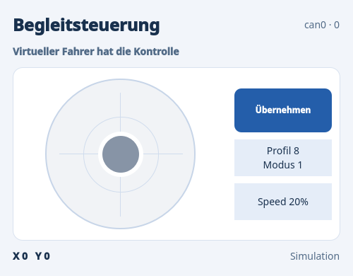

# R-net-Begleitsteuerung für Linux

[English](README.md) | [Deutsch](README.de.md)

Teil von dfreernet 1.5.0.

Qt-6-/C++17-Anwendung für die hier aufgezeichnete und getestete R-net-Konfiguration: Begleitgerät in Slot 0, Fahrergerät in Slot 1, PM in Slot 3 und Begleitprofil 8. Modus 1 ist Fahren, Modus 2 Sitzverstellung. Gerätebestand, Identitäten und Starttabellen kommen aus einem privaten Profil.

## Start ohne Optionen

```sh
qt_attendant/run.sh
```

Oder nach dem Bauen:

```sh
build/RELEASE/qt_attendant
```

Die Anwendung **vor dem Einschalten des Rollstuhls** öffnen. Standard ist Steuerungsbetrieb auf `can0`. `run.sh` richtet vor dem App-Start **can0 und can1 mit 125.000 Bit/s** ein und schaltet beide auf UP. Bereits mit dieser Bitrate aktive Adapter bleiben unverändert. Beim direkten Start der Binärdatei müssen die Schnittstellen bereits eingerichtet sein. Anschluss und galvanische Trennung beschreibt die [Verbindungsanleitung](../README.de.md). Das Original-Begleitgerät bleibt beim Emulationsbetrieb abgesteckt.

Für die Einrichtung werden `ip` (iproute2) und Python 3 benötigt. Fehlen Netzwerkrechte, versucht das Skript ausschließlich die nötigen `ip link set`-Befehle über `sudo -n`; die App selbst läuft als normaler Benutzer. Falls sudo ein Passwort verlangt, zuerst `sudo -v` im selben Terminal ausführen und danach `qt_attendant/run.sh` erneut starten. Beide Adapter müssen vorhanden sein. Fehlende Adapter, eine belegte Schnittstellen-Sperre oder ein Einrichtungsfehler verhindern den App-Start. Bereits erfolgte Einrichtungsschritte bleiben bei einem späteren Fehler bestehen. Für eine andere bekannte Bus-Bitrate kann `RNET_BITRATE` gesetzt werden; Standard ist `125000`. Die App verwendet weiterhin standardmäßig nur `can0`; `can1` wird eingerichtet, aber nicht von ihr verwendet.

Die App sendet zunächst ihren normalen Identitätsblock. Erkennt das System das registrierte BGM, folgt der normale Start. Fordert das System ausdrücklich eine Erst-Anmeldung an, beantwortet die App diese nach Prüfung des bekannten Gerätebestands. Sie überträgt ausschließlich die eigenen Slot-0-Tabellen und wartet abschnittsweise auf passende Antworten der anderen Geräte. Nach einer Erst-Anmeldung zeigt sie den erforderlichen Neustart an. Beim nächsten Einschalten bleibt die App geöffnet und versucht wieder den normalen Start. Es gibt keine Wiederholschleife nach einer Ablehnung oder Zeitüberschreitung.

Die Übernahme ist erst nach vollständig bestätigtem Identitäts-, Konfigurations- und Bereitschaftsdialog möglich. Sie erfolgt durch die Taste **Übernehmen** bei zentriertem Joystick. Profil-/Moduswechsel und Rückgabe warten zuerst auf die bestätigte Suspendierung. Bei der Rückgabe wählt das reale Fahrergerät seinen Modus; die App bestätigt erst dessen vollständige Antwortfolge.

## Bedienung

Neben dem Joystick gibt es drei Tasten:

- **Übernehmen / Zurückgeben:** Übernahme bei zentriertem Joystick; Rückgabe auch bei ausgelenktem Joystick mit sofortiger Neutralstellung.
- **Profil:** wechselt die beiden Modi innerhalb des festen Begleitprofils 8. Der neue Modus erscheint erst nach seiner Bestätigung.
- **Speed:** durchläuft 0, 20, 40, 60, 80 und 100 %. Der Startwert ist 20 %.

Joystick-Auslenkung und Speed sind getrennt: Der Joystick reicht in allen Modi bis ±100; Speed wird separat über `0A040000` gesendet. Die radiale Begrenzung, Neutralzone und Freigabeprüfung gelten weiter.



Die App bleibt beim Ausschalten des Rollstuhls geöffnet. Ein neues `00C` startet den nächsten Gerätedialog. Beim Schließen des Fensters, bei Strg+C oder SIGTERM versucht sie vor dem Beenden die bestätigte Rückgabe. Dieser Ablauf ist begrenzt; fehlt eine Bestätigung, endet die eigene Ausgabe und der Fehler wird protokolliert. Ein nicht abfangbarer Prozessabbruch kann keinen CAN-Dialog mehr ausführen.

## Fehlerbehandlung

- Keine Übernahme vor bestätigter Modulbereitschaft und Steuerungsbestätigung.
- Keine Joystick-/Speed-Ausgabe während ausstehender Moduswahl oder nach Rückgabe.
- Frische Eingaben aus der Bedienoberfläche werden benötigt; ihr Ausbleiben führt nach 250 ms zu Neutralstellung und Rückgabe. Ein gehaltenes Touch-/Maus-Eingabeelement wird aus der laufenden Oberfläche alle 50 ms aktualisiert.
- Beim Fokuswechsel bleiben Anmeldung, Übernahme, Profil/Modus und Speed erhalten. Die Joystick-Auslenkung geht auf Neutral. Die laufende Oberfläche aktualisiert im Hintergrund ausschließlich Neutral; beim Zurückwechseln setzt erst eine neue Betätigung die Bewegung fort. Ohne frische Oberflächenaktualisierung gilt weiterhin die 250-ms-Zeitüberwachung mit Rückgabe.
- `002` als RTR ist die Power-down-Barriere: keine weitere Ausgabe bis zum nächsten Einschaltmarker.
- Schnittstellenverlust, Sendefehler, widersprüchliche Identitäten und ausbleibende Protokollbestätigungen beenden den jeweiligen Ablauf. Die Empfangsverbindung wird erneut versucht; Steuerung setzt einen neuen Einschaltzyklus voraus.
- Pro Schnittstelle ist eine Live-Instanz erlaubt. Der Sender verwendet zusätzlich dieselbe Schnittstellen-Sperre wie die dfreernet-Controllerhelfer.

Die Protokollzustände gelten für den bekannten Gerätebestand. Frühere Tests am stationären Rollstuhl bestätigten Anmeldung/Wiederstart, Übernahme/Rückgabe, direkte Moduswechsel, Sitzverstellung und die minimale Speed-Stufe. Die neue automatische Auswahl des Startpfads und die zusätzlichen Fehler-/Beendigungspfade wurden anschließend **offline** geprüft; ein erneuter gemeinsamer Live-Test steht aus.

## Privates Profil

Ohne Optionen sucht die App zuerst nach `enrollment.json` im Qt-Anwendungskonfigurationsverzeichnis, unter Linux gewöhnlich `~/.config/LocalRNet/qt_attendant/`. Fehlt sie dort, verwendet der lokale Build `build/attendant-enrollment-tables.json`. Das vorhandene lokale Profil reicht hier für den Start ohne Optionen aus.

Das Profil enthält Identität, Kennbytes, vier erwartete Gegenstellen, vollständige Geräteidentitäten und die aufgezeichneten Tabellen. Fehlende oder ungültige Profile führen vor dem Öffnen der CAN-Verbindung zum Abbruch. Die frühere separate Identitätsdatei ist nicht mehr erforderlich.

Ein Profil aus privaten Originalmitschnitten erzeugen:

```sh
python3 qt_attendant/tools/build_enrollment_profile.py insys.txt startup.log \
  --output build/attendant-enrollment-tables.json
```

`startup.log` muss einen vollständigen passenden Identitätsblock enthalten. Das Werkzeug überschreibt kein abweichendes vorhandenes Profil. Profile, Originalmitschnitte, Konfigurationen und lokale Auswertungen gehören nicht in Git und werden nicht mitinstalliert.

## Diagnose und Offline-Prüfung

```sh
qt_attendant/run.sh --offline
qt_attendant/run.sh --observe
qt_attendant/run.sh --play-capture aufnahme.log
```

`run.sh` überspringt die Netzwerkeinrichtung bei `--offline`, `--observe`, Wiedergabe und Hilfe-/Versionsabfragen sowie automatisierten Oberflächenprüfungen. Für `--observe` muss der Adapter bereits aktiv sein.

`--offline` öffnet keine CAN-Schnittstelle und aktiviert die lokale Simulation. `--observe` liest ausschließlich mit und sperrt die Bedienung. Wiedergabe ist vollständig offline. Weitere Diagnoseoptionen sind `--registration-only`, `--interface NAME`, `--enrollment-profile DATEI` und `--language de_DE|en_US`. `--initial-enrollment` erzwingt eine Erst-Anmeldung für genau einen Einschaltvorgang; beim normalen Start wird diese Entscheidung vom beobachteten Systemdialog abhängig gemacht. Die alten Freigabeoptionen `--can-tx` und `--experimental-enrollment` sind nicht mehr nötig.

```sh
scripts/test.sh
```

Die Einrichtung von can0/can1 und die Startreihenfolge werden mit simulierten `ip`-/`sudo`-Befehlen geprüft. Weitere Tests verwenden Modellzustände, gespeicherte Mitschnitte, die Offline-Oberfläche oder einen absichtlich ungültigen Schnittstellennamen. Es gibt keine Integrationstests gegen einen angeschlossenen Rollstuhl. Private Mitschnittprüfungen werden bei fehlenden Dateien übersprungen. Der Unterprojektbuild benötigt Qt Quick, Quick Controls 2, Qt Test und QuickTest zusätzlich zu den [Hauptprojekt-Abhängigkeiten](../docs/DEVELOPMENT.md).

Passive eigene Aufzeichnungen sind weiterhin möglich:

```sh
qt_attendant/tools/capture.sh startup can0 60
```

Die Aufnahme bleibt im ignorierten Verzeichnis `build/attendant-captures/`. Sie startet keinen Sender.
