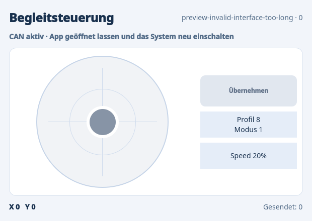
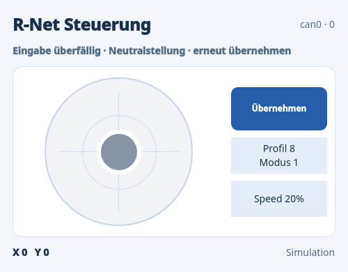
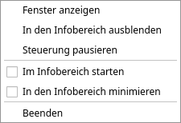
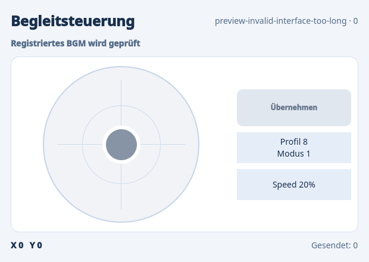

# R-Net Control for Linux

[English](README.md) | [Deutsch](README.de.md)

Part of dfreernet 1.5.1. The window, tray and launcher use **R-Net Control** (German: **R-Net Steuerung**) with a shared blue joystick icon.

Qt 6 / C++17 application for the captured and tested R-net configuration: attendant slot 0, passenger slot 1, PM slot 3 and attendant profile 8. Mode 1 is driving; mode 2 is seating. A private profile supplies device identities, expected peers and startup tables.

## Start without options

**The original BGM (attendant module) must be disconnected from the R-net bus before starting the emulator and must remain disconnected throughout emulator operation.** The emulator and original use the same captured module identity and slot; they must not be active on the bus together.

```sh
qt_attendant/run.sh
```

Or, after building:

```sh
build/RELEASE/qt_attendant
```

Open the application **before powering on the wheelchair**. Control on `can0` is the default. `run.sh` configures **can0 and can1 at 125,000 bit/s** and brings both UP before launching the app. Adapters already UP at this bitrate are left unchanged. Direct binary launches require interfaces to be configured beforehand. Follow the [connection and galvanic-isolation guide](../README.md).

Setup requires `ip` (iproute2) and Python 3. When network permissions are missing, the script retries only the required `ip link set` commands through `sudo -n`; the application itself runs as the normal user. If sudo requires a password, run `sudo -v` in the same terminal, then retry `qt_attendant/run.sh`. Both adapters must be present. Missing adapters, a held interface lease or setup errors prevent application startup. Completed setup steps remain in effect if a later step fails. Set `RNET_BITRATE` for another known bus bitrate; the default is `125000`. The application still uses only `can0` by default; `can1` is configured but not used by it.

At power-on, the BGM participates in the common device exchange. An unknown present BGM is registered on explicit system request; according to the user's observation, the system removes a previously registered BGM that is absent at power-on. Keep the emulator running across wheelchair power cycles. **If the BGM is already registered and CAN is running, a newly started app process can verify and reactivate the existing assignment.** This requires the private reconnect reference described below. Profiles without it still wait for common power-on. Hiding and control suspension preserve the module connection. Actual power-down or loss of a previously connected interface still latches output until the next `00C`.

Hint for profiles without a reconnect reference (offline, synthetic interface):



The app first sends its normal identity burst. If the system recognizes the registered BGM, normal startup follows. If the system explicitly requests initial enrollment, the app answers after validating the known peer set. It transmits only its own slot-0 table records and requires matching peer responses at each stage. After initial enrollment, it indicates the required restart. Keep the app open for the next power-on; it tries normal startup again. Rejection and timeout do not cause an enrollment retry loop.

Takeover requires confirmed identity, configuration and module readiness. Press **Take control** with the joystick centered. Mode changes and return wait for confirmed suspension before selecting the next mode/profile. On return, the physical passenger device selects its own mode; the app waits for the complete confirmation sequence.

## Controls

Three buttons accompany the joystick:

- **Take control / Return to passenger:** centered takeover; returning also works while displaced and immediately sends neutral.
- **Profile:** switches the two modes within fixed attendant profile 8. The displayed mode changes only after confirmation.
- **Speed:** cycles through 0, 20, 40, 60, 80 and 100%. The initial setting is 20%.

Joystick travel and speed are independent. Joystick axes reach ±100 in every mode; speed is sent separately via `0A040000`. Radial bounds, the neutral zone and enable checks remain enforced.



The app stays open when the wheelchair powers down. A new `00C` begins the next startup exchange. X, Alt+F4 and ordinary window closing hide the app in the tray. Fully exit through **Quit** in the tray context menu; this action, Ctrl+C and SIGTERM request confirmed return before exiting. This handshake is bounded; missing confirmation stops output and is logged. An uncatchable process termination cannot execute a CAN exchange.

## Failure handling

- No takeover before confirmed module readiness and control acknowledgement.
- No joystick/speed output while a mode selection is pending or after return.
- Fresh UI input is required; its absence causes neutral and return after 250 ms. A held pointer/touch input is refreshed by the running UI every 50 ms.
- Focus changes preserve registration, ownership, profile/mode and speed. Joystick displacement returns to neutral. The running UI refreshes only neutral in the background; a new gesture is required to move after returning. Missing fresh UI updates still trigger the 250-ms watchdog and return.
- `002` RTR is the power-down barrier: no further output until the next power-on marker.
- Interface loss, send failures, conflicting identities and missing protocol acknowledgements stop the affected exchange. Receive connection retries are bounded in frequency; control requires another power-on cycle.
- One live app instance per interface. The sender also uses the same interface lease as dfreernet's controller helpers.

The protocol state machines target the known device arrangement. Earlier stationary-wheelchair tests confirmed enrollment/restart, takeover/return, direct mode changes, seating adjustment and the lowest speed setting. The user subsequently confirmed registration, deregistration, reconnect while the system is running, and control for this local configuration. Failure/termination paths also have offline coverage; this is not a general acceptance or endurance test.

## System tray and control suspension

```sh
qt_attendant/run.sh --start-in-tray
qt_attendant/run.sh --minimize-to-tray
qt_attendant/run.sh --no-tray
```

`--start-in-tray` starts hidden in the system tray. `--minimize-to-tray` hides the window there when minimized. The tray context menu also offers both settings and saves them for future launches. Command-line options affect the current launch. `--no-tray` ignores saved tray preferences and starts visibly. Diagnostic/offline launches do not use saved tray preferences; explicitly select `--offline --start-in-tray` for a local test.

- **Show window:** reopen the window; clicking the icon also restores it.
- **Hide to tray:** hide only the window. Registration, ownership, mode and speed remain intact, while the joystick becomes neutral. Moving after restoration requires a new gesture.
- **Suspend control:** immediately center the joystick, disable local controls and return existing ownership through the confirmed passenger-return exchange. The BGM stays registered and connected. A pending takeover is also returned if its confirmation arrives later. Once return is confirmed, the window hides in the tray; without prior ownership it hides immediately. Failed return keeps the window visible to show the error.
- **Resume control:** enable local controls after return completes. Ownership is never restored automatically; explicitly press **Take control** again. The window is restored. Mode and speed are preserved.
- **Quit:** restore the window if needed to show status, then use the normal return-before-exit handshake. X, Alt+F4 and ordinary window closing do not exit the app. Ctrl+C and SIGTERM still use the orderly termination path.

Suspension survives wheelchair power cycles while the app runs. It is not saved across app restarts. Without a system tray, the window remains accessible and ordinary closing is intercepted. `--no-tray` remains an explicit diagnostic/recovery override with ordinary window closing; if the tray disappears, a hidden window is restored. Automated screenshots force a visible window.



## Start automatically at Linux login

After building, run once:

```sh
python3 qt_attendant/tools/install_autostart.py
```

The installer creates `~/.config/autostart/dfreernet-attendant.desktop` (respecting `XDG_CONFIG_HOME`). At the next login, the existing RELEASE binary starts directly with `--start-in-tray --minimize-to-tray`, without rebuilding or requesting a password. If the desktop tray appears later, the app detects it and hides its initial window. The existing instance guard prevents a second emulator.

This autostart does not configure CAN network interfaces. Configure them through Linux or beforehand using `qt_attendant/run.sh`; if `can0` is missing/down, the app stays open and retries reception. A profile with a reconnect reference can verify an already registered BGM on the running bus; otherwise startup requires the next common power-on exchange. The private profile must be available as for a normal start.

Rerun the installer after moving the project. Disable the entry in Linux startup settings or remove this generated `.desktop` file to turn off autostart. `--preview` prints the entry without installing; `--mode DEBUG` selects an existing debug binary.

## Private profile

Without options, the app first looks for `enrollment.json` in Qt's application configuration directory, typically `~/.config/LocalRNet/qt_attendant/` on Linux. Otherwise the local build uses `build/attendant-enrollment-tables.json`. The existing local profile is sufficient here for starting without options.

The profile holds identity, challenge keys, four expected peers, full device identities and captured tables. Missing or invalid profiles abort before opening CAN. The old separate identity file is no longer needed.

Generate a profile from private original captures:

```sh
python3 qt_attendant/tools/build_enrollment_profile.py insys.txt startup.log \
  --output build/attendant-enrollment-tables.json
```

`startup.log` must contain a complete matching identity burst. The tool refuses to overwrite a different existing profile. Profiles, original captures, configurations and local analyses stay out of Git and are not installed with the application.

## Reconnect to an already running system

Augment the private profile from a successful normal startup of the registered original BGM:

```sh
python3 qt_attendant/tools/resume_reference.py \
  --profile build/attendant-enrollment-tables.json \
  --capture ctrlsys.txt --in-place
```

The tool requires matching complete identity bursts for all five slots, nine successful slot-0 POP reads and confirmed readiness of all devices. It adds `resume_reference`, retains a private `-before-resume.json` backup and transmits nothing on CAN. Profiles and captures remain private. The normal profile generator is unchanged; this reference is optional.

On app restart with CAN already running, repeated passenger heartbeats must first match the profile. The app then reads C8/C9 identities of all four peers using the established 78F/2F identification addressing, verifies their slot assignments and performs the known slot-0 configuration read exchange. Both parameter values, flags and the profile-8 assignment must exactly match the reference. The reference for this local installation was extracted from the original capture and added.

Only then does the UI report **“Registered BGM active; takeover is available”**. Activation sends no identity bursts, initial tables, readiness resets, profile selection or joystick values. **Take control** remains a separate action requiring PM confirmation. Verification is bounded, never retries automatically and closes an opened POP read session on cancellation. Different devices, unknown configuration or another active slot-0 sender keep controls disabled. A new `00C` cancels reconnect verification and starts the normal power-on path.

Offline preview of reconnect verification (synthetic interface):



The user confirmed successful reconnect and control on the existing system. Reconnect remains experimental and limited to the verified device assignment and configuration reference; this does not establish compatibility with other systems or firmware.

## Diagnostics and offline verification

```sh
qt_attendant/run.sh --offline
qt_attendant/run.sh --observe
qt_attendant/run.sh --play-capture capture.log
```

`run.sh` skips network setup for `--offline`, `--observe`, playback, help/version queries and automated UI checks. For `--observe`, the adapter must already be UP.

`--offline` opens no CAN interface and enables local simulation. `--observe` receives only and disables controls. Playback is entirely offline. Other diagnostic options include `--registration-only`, `--interface NAME`, `--enrollment-profile FILE` and `--language de_DE|en_US`. `--initial-enrollment` forces initial enrollment for one power-on only; normal startup determines the need from the observed system exchange. The old `--can-tx` and `--experimental-enrollment` gates are no longer required.

```sh
scripts/test.sh
```

Tests simulate `ip`/`sudo` commands to check can0/can1 setup and launch ordering. Other tests use pure state machines, saved captures, offline UI or a deliberately invalid interface name. There are no integration tests against a live wheelchair. Private capture checks skip when their files are unavailable. The subproject needs Qt Quick, Quick Controls 2, Qt Test and QuickTest in addition to the [main development dependencies](../docs/DEVELOPMENT.md).

Passive capture remains available:

```sh
qt_attendant/tools/capture.sh startup can0 60
```

Logs stay in ignored `build/attendant-captures/`. This command starts no transmitter.
