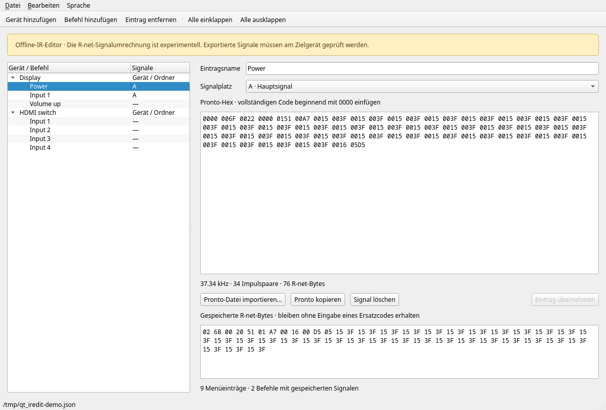

# qt_iredit

[English](README.md) | [Deutsch](README.de.md)

Teil von dfreernet 1.5.1.

Eigenständiger Qt-Widgets-Editor für lokale R-net-Menüs im Format `.RnIR3` und
Pronto-Hex-Signale. Er öffnet keine CAN-Schnittstelle und bietet keinen
Controller-Lese-/Schreibbefehl. Zur Laufzeit benötigt er weder Wine noch den
OEM-Programmer oder IRConfigurator.

Editor mit synthetischen Beispieldaten:



## Start

Die Linux-/C++17-/Qt-6.10+-Buildumgebung des Hauptprojekts verwenden:

```bash
qt_iredit/run.sh
qt_iredit/run.sh --language de_DE '/pfad/zum/menue.RnIR3'
# Nach dem normalen Projektbuild:
build/RELEASE/qt_iredit '/pfad/zum/menue.RnIR3'
```

Ein separater Build wird ebenfalls unterstützt:

```bash
cmake -S qt_iredit -B build/ir-editor -G Ninja -DCMAKE_BUILD_TYPE=RelWithDebInfo
cmake --build build/ir-editor --parallel 2
ctest --test-dir build/ir-editor --output-on-failure
build/ir-editor/qt_iredit
```

Englisch und Deutsch sind im Menü „Sprache“ wählbar. Die Auswahl wird getrennt
von den dfreernet-Einstellungen gespeichert.

## Eigene Codes eingeben

1. Ein vorhandenes `.RnIR3`-Menü öffnen oder **Datei → Neues IR-Menü** wählen.
2. Mit **Gerät hinzufügen** ein Gerät erstellen, auswählen und mit
   **Befehl hinzufügen** jede benötigte Taste anlegen.
3. Den Befehl auswählen. Einen vollständigen Pronto-Hex-Block einschließlich der
   vier Header-Wörter einfügen oder **Pronto-Datei importieren…** verwenden.
4. Frequenz, Impulsanzahl und Prüfergebnis kontrollieren und **Eintrag übernehmen**
   wählen. Signalplatz A ist das Hauptsignal; B erhält oder bearbeitet ein
   Umschalt-/Alternativsignal. **Signal löschen** entfernt gezielt diesen Platz.
5. Als `.RnIR3`-Menü oder bearbeitbares JSON-Projekt speichern. **Speichern unter**
   erzeugt eine separate Datei. Rückgängig/Wiederholen gilt auch für gelöschte
   Geräte und ihre Befehle. Speichern ersetzt die Datei atomisch.

Beim Wechsel des Eintrags werden gültige ausstehende Änderungen übernommen.
Ungültige Entwürfe bleiben im Editor erhalten und verhindern den Auswahlwechsel.
Beim Schließen oder Öffnen einer anderen Datei können ungespeicherte Änderungen
gespeichert, verworfen oder weiterbearbeitet werden.

Mit **Alle einklappen** und **Alle ausklappen** in der Werkzeugleiste wird der gesamte Gerätebaum einschließlich Unterordnern ein- oder ausgeklappt. Aktueller Eintrag und Entwurf bleiben dabei erhalten.

Vorhandene Namen, Hierarchie, Flags, beide Signalplätze und acht
Verknüpfungsindizes bleiben erhalten. Nicht nach Pronto umrechenbare Formate
erscheinen als gespeicherte Bytes und bleiben ohne Eingabe eines Ersatzsignals
erhalten. Eine reine Umbenennung bewahrt ursprüngliche Codebytes und Flags.

## Formatgrenzen

- Unterstützt wird die Pronto-Menüdarstellung **Version 4**, die der lokal
  untersuchte IRConfigurator 2.3.2.0 als `.RnIR3` speichert. Ältere Omni-Formate
  `.RnIR`/`.RnIR2` und unbekannte zusätzliche Menüfelder werden abgelehnt und
  nicht stillschweigend verworfen.
- Der begrenzte native Datenleser verarbeitet die benötigten
  [NRBF-Datensätze](https://learn.microsoft.com/en-us/openspecs/windows_protocols/ms-nrbf/ca3ad2bc-777b-413a-a72a-9ba6ced76bc3).
  Er lädt keine .NET-Typen und führt keine Deserialisierungsfunktionen aus.
  Grenzen sind unter anderem 4 MiB Eingabedateigröße, 255 Menüeinträge und eine
  feste Tabelle mit acht Verknüpfungen.
- Pronto-Eingaben unterstützen modulierte `0000`-Rohcodes mit einer Sequenz,
  entweder Anfangs- oder Wiederholungssequenz. Getrennte Anfangs- **und**
  Wiederholungssequenzen, kompakte Protokollcodes sowie innere Impulsdauern über
  einem Byte lassen sich derzeit nicht umrechnen. Ungültige Daten werden nicht
  stillschweigend gekürzt.
- Die Umrechnung verwendet die von
  [HARCToolbox](https://www.harctoolbox.org/wholesite.html) beschriebene
  Pronto-Trägerperiode und ein **experimentell abgeleitetes R-net-Format 2**:
  Trägerperiodenteiler, Impulspaaranzahl, 16-Bit-Anfangs-/Endpaare und innere
  Impulse in einzelnen Bytes. Eine strukturell gültige Datei bestätigt weder
  korrekte physische IR-Ausgabe noch Kompatibilität zum Zielgerät.
- Der Editor prüft nicht die Kapazität und Firmware jedes Controllers. Bei
  späterer Übertragung mit IRConfigurator das aktuelle IR-Menü des Controllers
  separat sichern und die tatsächlich ausgegebenen Signale prüfen.

Herstellerspezifische Codes und private Controllerdateien werden nicht mitgeliefert.

## Offline-Prüfungen

`scripts/test.sh` des Hauptprojekts enthält `qt_ir_editor`. Geprüft werden
fehlerhafte Pronto-/NRBF-Daten, Menü-/JSON-Rundläufe, Eltern-/Verknüpfungsverweise
beim Löschen, Erhalt von Alternativsignalen, lokales Speichern und GUI-Bearbeitung.
Physische CAN-Tests gehören nicht zu diesem Unterprojekt.

Lokaler Dateirundlauf ohne sichtbares Fenster:

```bash
QT_QPA_PLATFORM=offscreen build/RELEASE/qt_iredit \
  --export-rnir3 '/pfad/zur/separaten-ausgabe.RnIR3' '/pfad/zur/eingabe.RnIR3'
```

`tools/interop_check.cs` bietet eine optionale Gegenprüfung mit der eigenen
Originalinstallation. Mit einem 32-Bit-C#-Compiler und Verweis auf
`System.Windows.Forms.dll` kompilieren, anschließend unter Windows oder im
eingerichteten Wine ausführen:

```text
interop_check.exe IRConfigurator.exe vorher.RnIR3 nachher.RnIR3
```

Der Test vergleicht alle Eintragsfelder, beide Signale und sämtliche
Verknüpfungsindizes und nutzt anschließend die originale Menübaumfunktion,
ohne einen Gerätetransport zu initialisieren. Originalbinärdateien werden nicht
mitgeliefert. Die lokale Entwicklungsprüfung erhielt alle 101 Einträge eines
privaten Menüs beim nativen Export und Einlesen mit der Originalbibliothek.
