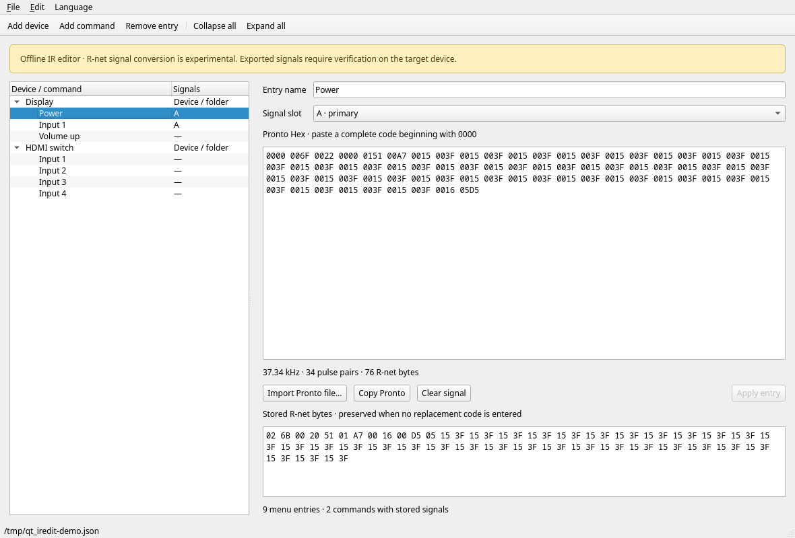

# qt_iredit

[English](README.md) | [Deutsch](README.de.md)

Part of dfreernet 1.5.1.

A standalone Qt Widgets editor for local R-net `.RnIR3` menus and Pronto Hex
signals. It opens no CAN interface and has no controller read/write command.
It does not require Wine, the OEM Programmer, or IRConfigurator at runtime.

Editor with synthetic example data:



## Start

Use the main project's Linux/C++17/Qt 6.10+ build environment:

```bash
qt_iredit/run.sh
qt_iredit/run.sh --language de_DE '/path/to/menu.RnIR3'
# After the normal project build:
build/RELEASE/qt_iredit '/path/to/menu.RnIR3'
```

A separate build is also supported:

```bash
cmake -S qt_iredit -B build/ir-editor -G Ninja -DCMAKE_BUILD_TYPE=RelWithDebInfo
cmake --build build/ir-editor --parallel 2
ctest --test-dir build/ir-editor --output-on-failure
build/ir-editor/qt_iredit
```

English and German are available in the Language menu. The selection is saved
separately from dfreernet's preferences.

## Enter your own codes

1. Open an existing `.RnIR3` menu, or choose **File → New IR menu**.
2. Use **Add device**, select that device, and use **Add command** for each key.
3. Select the command. Paste a complete Pronto Hex block, including its four
   header words, into the Pronto field, or use **Import Pronto file…**.
4. Check the displayed frequency, pulse count and validation result, then choose
   **Apply entry**. Slot A is the primary signal; slot B preserves or edits an
   alternate/toggle signal. **Clear signal** explicitly removes that slot's data.
5. Save the menu as `.RnIR3`, or save an editable JSON project. **Save as** creates
   a separate file. Undo/redo is available for changes, including deleted devices
   and their commands. Saves use an atomic file replacement.

Selecting another entry applies valid pending edits. Invalid drafts remain in
the editor and block the selection change. Closing or opening another file asks
whether unsaved work should be saved, discarded or retained.

Use **Collapse all** or **Expand all** in the toolbar to fold or unfold the entire device tree, including nested folders. These actions keep the current entry and draft intact.

Existing names, hierarchy, flags, both signal slots and eight shortcut indices
are preserved. Formats not convertible to Pronto remain visible as stored bytes
and are kept when no replacement signal is supplied. Rename an entry without
replacing its signal to keep its original code bytes and flags.

## Format limits

- Supports the Pronto-menu **version 4** representation saved as `.RnIR3` by the
  locally investigated IRConfigurator 2.3.2.0. Older Omni `.RnIR`/`.RnIR2` formats
  and unknown additional menu fields are rejected instead of being dropped.
- The reader is a bounded native data parser for the required
  [NRBF records](https://learn.microsoft.com/en-us/openspecs/windows_protocols/ms-nrbf/ca3ad2bc-777b-413a-a72a-9ba6ced76bc3).
  It never loads .NET types or runs deserialization hooks. Limits include a
  4 MiB input file, 255 menu entries and a fixed eight-entry shortcut table.
- Pronto input supports modulated raw `0000` codes with one sequence, either an
  introduction or a repeat sequence. Distinct introduction **and** repeat
  sequences, compact protocol codes, and inner pulse durations exceeding one
  byte cannot currently be converted. Invalid input is not silently shortened.
- The conversion uses the Pronto carrier period described by
  [HARCToolbox](https://www.harctoolbox.org/wholesite.html) and an **experimentally
  inferred R-net format 2** layout: carrier-period divisor, pulse-pair count,
  16-bit leading/trailing pairs and byte-sized inner pulses. A structurally valid
  file does not establish correct physical IR output or target-device compatibility.
- This editor does not validate a menu against every controller's capacity or
  firmware. If you later use IRConfigurator to transfer a file, preserve a separate
  backup of the controller's current IR menu and verify the actual signals.

No manufacturer-specific codes or private controller files are bundled.

## Offline checks

The main project's `scripts/test.sh` includes `qt_ir_editor`. It checks malformed
Pronto and NRBF data, menu and JSON round trips, parent/shortcut remapping during
deletion, preservation of alternate signals, local saving and GUI editing.
Physical CAN tests are not part of this subproject.

For a local file round trip without opening a window:

```bash
QT_QPA_PLATFORM=offscreen build/RELEASE/qt_iredit \
  --export-rnir3 '/path/to/separate-output.RnIR3' '/path/to/input.RnIR3'
```

An optional check against your own original installation is provided in
`tools/interop_check.cs`. Compile it with a 32-bit C# compiler and a reference to
`System.Windows.Forms.dll`, then run it on Windows or under configured Wine:

```text
interop_check.exe IRConfigurator.exe before.RnIR3 after.RnIR3
```

It compares every item's fields, both signals and all shortcut indices, then
uses the original GUI tree function without initializing a device transport.
No original binaries are supplied. The local development check preserved all
101 entries in a private menu through native export and the original reader.
